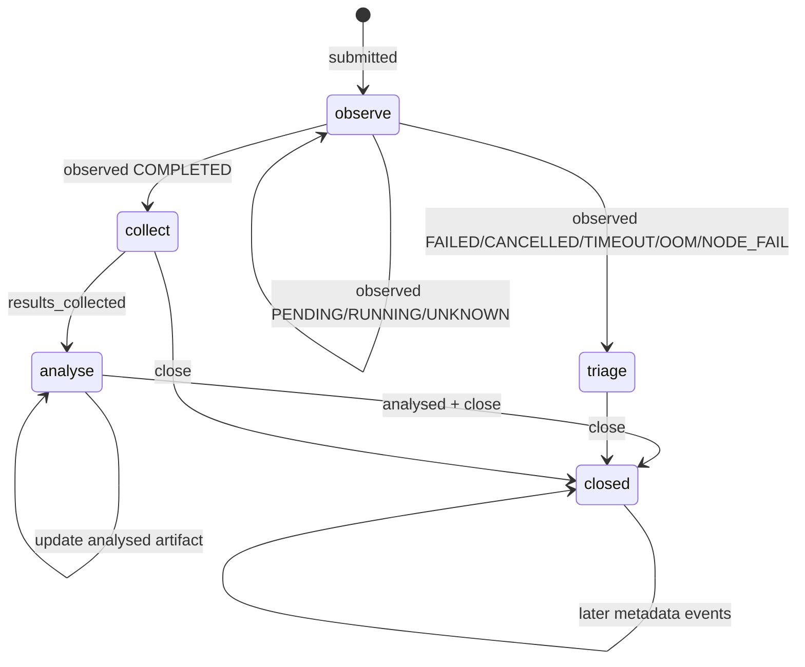

# Submission Log Workflow

`hpc submit` records successful real Slurm submissions in an append-only local
JSONL log, normally:

```text
~/.config/hpc-tools/submissions.jsonl
```

The log is not a mutable status database. It is an event stream. `hpc
submissions list` reconstructs the current view by replaying events for each
`run_id`.

This matters for two reasons:

- you can resume long-running work after restarting Codex or your shell
- handled runs stay auditable because earlier events are never deleted

## Commands

The main user-facing commands are:

```bash
hpc submissions list
hpc submissions list --all
hpc --profile <profile> submissions observe
hpc submissions mark-collected <run-id> --path <results-path>
hpc submissions mark-analysed <run-id> --path <report-path>
hpc submissions close <run-id> --reason <reason>
```

## Event Model

The current event types are:

- `submitted`
- `observed`
- `results_collected`
- `analysed`
- `closed`

`submitted` is appended automatically by `hpc submit` and by higher-level
wrappers such as `hpc r submit-install` when the real `sbatch` call succeeds.

The other events are appended explicitly through `hpc submissions ...`
subcommands.

## Output Semantics

`hpc submissions list` prints these columns:

- `RUN_ID`: durable local identifier for one submitted run
- `PROFILE`: the `hpc-tools` profile that submitted the job
- `CLUSTER`: Slurm cluster name if known
- `JOBID`: Slurm job ID
- `STATE`: latest observed Slurm state, or `SUBMITTED` if the run has not been
  observed yet
- `ACTION`: derived next-step hint from the event history
- `JOBSCRIPT`: job script name recorded at submission time

The important distinction is:

- `STATE` is an observed scheduler state
- `ACTION` is a local workflow state derived from both scheduler observations
  and manual lifecycle events

## Action Semantics

`ACTION` is derived with the following meaning:

| `ACTION` | Meaning |
| --- | --- |
| `observe` | The run still needs Slurm observation, or is in a non-terminal state such as `PENDING` or `RUNNING`. |
| `collect` | Slurm reached `COMPLETED`, but the output or result artifact has not yet been recorded with `mark-collected`. |
| `analyse` | Results were collected, but the run has not yet been marked analysed. |
| `triage` | Slurm reached a failure-like terminal state such as `FAILED`, `CANCELLED`, `TIMEOUT`, `OUT_OF_MEMORY`, or `NODE_FAIL`, and the run still needs diagnosis or explicit closure. |
| `closed` | The run has a `closed` event anywhere in its history and is considered handled. |

Two consequences follow from this:

1. `closed` is terminal at the workflow level. Even if later metadata events are
   appended, the run remains hidden from the default active view.
2. `collect` and `analyse` are not scheduler states. They are local reminders
   about remaining work after the job itself has already completed.

## Default vs Full View

`hpc submissions list` shows only active runs. A run is active if its derived
`ACTION` is not `closed`.

`hpc submissions list --all` replays the full history and includes closed runs.

So:

- use `list` for current work
- use `list --all` for audit/history

## Recommended Workflow

For a normal successful job:

1. submit with `hpc submit` or a higher-level wrapper
2. observe until the job reaches `COMPLETED`
3. record the result artifact with `mark-collected`
4. record the analysis artifact with `mark-analysed`
5. close the run with `close --reason done`

For a failed job:

1. observe until the job reaches `FAILED` or another failure-like state
2. inspect output and diagnose the cause
3. if the run is no longer relevant, close it explicitly
4. if a corrected rerun succeeds and the failed run only served diagnosis, close
   the failed run with a superseded reason

Example:

```bash
hpc --profile genius submissions observe
hpc submissions mark-collected <run-id> --path /remote/results/output.txt
hpc submissions mark-analysed <run-id> --path /remote/results/report.md
hpc submissions close <run-id> --reason done
```

Example for a superseded failed attempt:

```bash
hpc submissions close <failed-run-id> --reason superseded-by-<new-jobid>
```

## State Diagram



## Notes

- Do not edit `submissions.jsonl` directly unless the CLI is unavailable or
  broken.
- `observe` appends Slurm accounting snapshots; it does not collect result files
  for you.
- `mark-collected` and `mark-analysed` record paths only. They do not copy
  files.
- The log is intentionally append-only; current state is derived, not updated in
  place.
