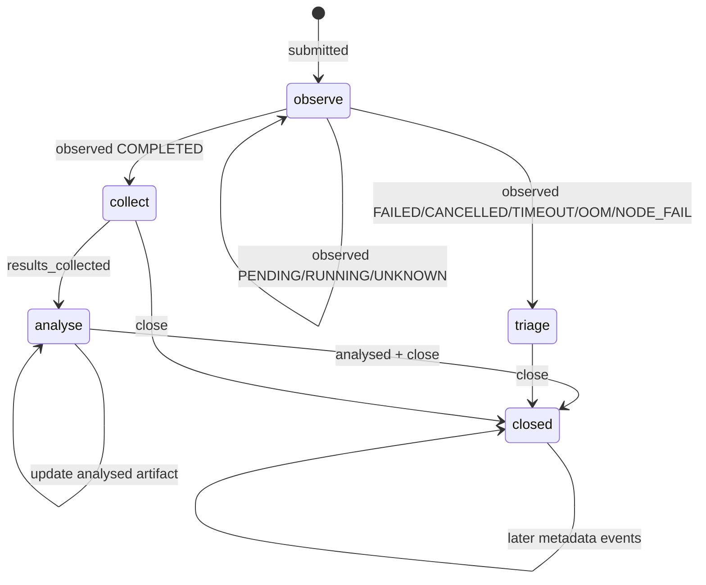

# Tracking work from submission to analysis

Slurm tells you whether a job is pending, running, or finished. It does not
tell you whether the results were collected, interpreted, or deliberately
abandoned. The hpc-tools submission log bridges that gap with a small local
workflow record.

The log is useful for work that spans several sessions: long jobs, package
installation jobs, hardware probes, benchmark campaigns, and analyses whose
results need attention after Slurm has finished.

It is not a workflow engine. It does not transfer files, run an analysis,
cancel jobs, or prove that a recorded path exists.

## Submission Log Workflow

`hpc submit` records successful real Slurm submissions in an append-only local
JSONL log, normally:

```text
~/.config/hpc-tools/submissions.jsonl
```

The log is not a mutable status database. It is an event stream. `hpc
submissions list` reconstructs the current view by replaying events for each
`run_id`.

This matters for two reasons:

- you can resume long-running work after restarting Codex or your shell;
- handled runs stay auditable because earlier events are never deleted.

## Know what creates a record

A `submitted` event is written after hpc-tools parses a successful real
`sbatch` response. This includes the core `hpc submit` command and higher-level
wrappers such as `hpc python submit-install` and `hpc r submit-install`.

No record is created for:

- `--dry-run` previews;
- `--test-only` validation;
- a submission that Slurm rejects;
- jobs submitted directly with `sbatch` or through another tool;
- a real submission whose response hpc-tools cannot parse.

The last case needs particular care. The remote job may exist even though the
local record does not. Inspect `hpc jobs` or the reported Slurm job ID before
retrying, or you may submit the workload twice.

Each record has two identifiers:

- `JOBID` is assigned by Slurm and is used for queue and accounting queries;
- `RUN_ID` is assigned locally and is used by `hpc submissions` lifecycle
  commands.

Do not substitute one for the other. Copy the run ID from `submissions list`
when recording collection, analysis, or closure.

## Commands

The main user-facing commands are:

```bash
hpc submissions list
hpc submissions list --all
hpc --profile <profile> submissions observe
hpc submissions mark-collected <run-id> --path <results-path>
hpc submissions mark-analysed <run-id> --path <report-path>
hpc submissions close <run-id> --reason <reason>
```

Commands that modify the workflow log are local operations and do not require
the cluster profile. `observe` is different: it needs `--profile` because it
queries Slurm accounting on the associated cluster.

Use a non-default log only when you have a deliberate reason to isolate a
workflow:

```bash
hpc submissions --log ./campaign-submissions.jsonl list
hpc --profile <profile> submissions \
    --log ./campaign-submissions.jsonl observe
```

Pass the same `--log` path to every command in that workflow. A custom log is
not merged with the default log automatically.

## Event Model

The current event types are:

- `submitted`
- `observed`
- `results_collected`
- `analysed`
- `closed`

`submitted` is appended automatically by `hpc submit` and by higher-level
wrappers such as `hpc r submit-install` when the real `sbatch` call succeeds.

The other events are appended explicitly through `hpc submissions ...`
subcommands.

Events contain timestamps. Submission events also retain the profile, Slurm
job and cluster identifiers when known, remote directory, job script, effective
submission command, and hpc-tools resource overrides. This is useful
operational provenance, but it is not a complete scientific record: preserve
the source revision, inputs, configuration, module or container versions, and
random seeds separately.

## Output Semantics

`hpc submissions list` prints these columns:

- `RUN_ID`: durable local identifier for one submitted run
- `PROFILE`: the `hpc-tools` profile that submitted the job
- `CLUSTER`: Slurm cluster name if known
- `JOBID`: Slurm job ID
- `STATE`: latest observed Slurm state, or `SUBMITTED` if the run has not been
  observed yet
- `ACTION`: derived next-step hint from the event history
- `JOBSCRIPT`: job script name recorded at submission time

The important distinction is:

- `STATE` is an observed scheduler state
- `ACTION` is a local workflow state derived from both scheduler observations
  and manual lifecycle events

## Action Semantics

`ACTION` is derived with the following meaning:

| `ACTION` | Meaning |
| --- | --- |
| `observe` | The run still needs Slurm observation, or is in a non-terminal state such as `PENDING` or `RUNNING`. |
| `collect` | Slurm reached `COMPLETED`, but the output or result artifact has not yet been recorded with `mark-collected`. |
| `analyse` | Results were collected, but the run has not yet been marked analysed. |
| `triage` | Slurm reached a failure-like terminal state such as `FAILED`, `CANCELLED`, `TIMEOUT`, `OUT_OF_MEMORY`, or `NODE_FAIL`, and the run still needs diagnosis or explicit closure. |
| `closed` | The run has a `closed` event anywhere in its history and is considered handled. |

Two consequences follow from this:

1. `closed` is terminal at the workflow level. Even if later metadata events are
   appended, the run remains hidden from the default active view.
2. `collect` and `analyse` are not scheduler states. They are local reminders
   about remaining work after the job itself has already completed.

The current `triage` mapping recognizes `FAILED`, `CANCELLED`, `TIMEOUT`,
`OUT_OF_MEMORY`, and `NODE_FAIL`. Other terminal Slurm states can remain under
the generic `observe` action. Always read `STATE`; handle and close an unusual
terminal state deliberately rather than following `ACTION` mechanically.

## Default vs Full View

`hpc submissions list` shows only active runs. A run is active if its derived
`ACTION` is not `closed`.

`hpc submissions list --all` replays the full history and includes closed runs.

So:

- use `list` for current work
- use `list --all` for audit/history

Closing a run hides it from the default view but does not remove its events.
There is currently no reopen command. Because any `closed` event makes closure
terminal in the derived workflow state, close only when the run is genuinely
handled.

## Observe scheduler state

Observe all active runs for one profile:

```bash
hpc --profile <profile> submissions observe
```

Or observe one local run ID:

```bash
hpc --profile <profile> submissions observe <run-id>
```

The command replays the local log, selects active records belonging to the
chosen profile, queries `sacct` for their recorded Slurm job and cluster IDs,
and appends an `observed` event for each successful query. Use the same profile
that submitted the run. A run ID belonging to another profile is deliberately
not queried through the selected connection.

Observation uses accounting rather than the live queue. Shortly after
submission or completion, accounting can return no matching row; hpc-tools
then records `UNKNOWN`. Wait for accounting to catch up and observe again. For
a currently pending or running job, use `hpc jobs` or `hpc job` when you need
live queue detail.

Preview the accounting commands without appending observations:

```bash
hpc --profile <profile> --dry-run submissions observe
```

If one accounting query fails, inspect its error and query the job directly
with `hpc sacct`. Do not close the run merely because one observation attempt
could not reach accounting.

## Record results and analysis

After a job reaches `COMPLETED`, verify the output before marking it collected.
Then record the artifact location:

```bash
hpc submissions mark-collected <run-id> \
    --path /remote/project/results/run-123456
```

The path may be local or remote. It is stored as text; hpc-tools neither copies
the artifact nor checks that the path exists. Prefer a stable path that another
person can interpret. Avoid transient node-local scratch paths that disappear
with the allocation.

After completing the interpretation or report, record that artifact too:

```bash
hpc submissions mark-analysed <run-id> \
    --path reports/run-123456-analysis.html
```

`mark-analysed` does not execute a notebook, validate a report, or imply that
the scientific result is correct. It records that you consider the analysis
artifact to exist and be associated with this run.

The current commands do not validate that a supplied run ID already exists.
Always copy it from `submissions list`; a typo would append an unrelated event
to the JSONL stream.

## Recommended Workflow

For a normal successful job:

1. submit with `hpc submit` or a higher-level wrapper
2. observe until the job reaches `COMPLETED`
3. record the result artifact with `mark-collected`
4. record the analysis artifact with `mark-analysed`
5. close the run with `close --reason done`

For a failed job:

1. observe until the job reaches `FAILED` or another failure-like state
2. inspect output and diagnose the cause
3. if the run is no longer relevant, close it explicitly
4. if a corrected rerun succeeds and the failed run only served diagnosis, close
   the failed run with a superseded reason

Example:

```bash
hpc --profile genius submissions observe
hpc submissions mark-collected <run-id> --path /remote/results/output.txt
hpc submissions mark-analysed <run-id> --path /remote/results/report.md
hpc submissions close <run-id> --reason done
```

Example for a superseded failed attempt:

```bash
hpc submissions close <failed-run-id> --reason superseded-by-<new-jobid>
```

Use a reason that will still be meaningful months later. A new Slurm job ID is
helpful, but the replacement run ID is even less ambiguous when several
profiles or clusters are involved.

## Resume work after a restart

The default active view is the restart point:

```bash
hpc submissions list
```

Work from the `ACTION` column:

1. `observe`: query scheduler state with the record's profile;
2. `collect`: inspect and retain the result, then record its path;
3. `analyse`: perform the required analysis and record its artifact;
4. `triage`: preserve logs, diagnose the failure, then rerun or close;
5. `closed`: visible only with `list --all`; no action remains.

The log is local to the machine and configuration directory. Restarting a
shell or Codex does not lose it, but moving to another workstation does unless
you transfer it deliberately. A copied log can contain remote paths, job names,
accounting output, and other operational metadata; protect it according to the
sensitivity of the project.

## Audit completed work

List the full reconstructed history:

```bash
hpc submissions list --all
```

The table is a summary of the latest derived state. For a detailed audit, the
append-only JSONL file retains all recorded events and raw accounting output.
Read it with normal JSONL-aware tooling, but do not rewrite or reorder it.

An event log is not a backup. Preserve result artifacts and scientific
provenance in project or archival storage, and follow the cluster's retention
policy.

## State Diagram



## Notes

- Do not edit `submissions.jsonl` directly unless the CLI is unavailable or
  broken.
- `observe` appends Slurm accounting snapshots; it does not collect result files
  for you.
- `mark-collected` and `mark-analysed` record paths only. They do not copy
  files.
- The log is intentionally append-only; current state is derived, not updated in
  place.
- `close` changes only the local workflow view. It does not call `scancel`,
  delete remote output, or release storage.
- Events are not synchronized automatically between machines or users.

See [Running Slurm jobs](slurm-jobs.md) for submission and failure diagnosis,
and [Software environments and dependencies](software-environments.md) for
installation jobs that participate in the same tracking workflow.
The [end-to-end recipes](recipes.md#resume-unfinished-work-after-a-restart)
provide a compact restart checklist.
